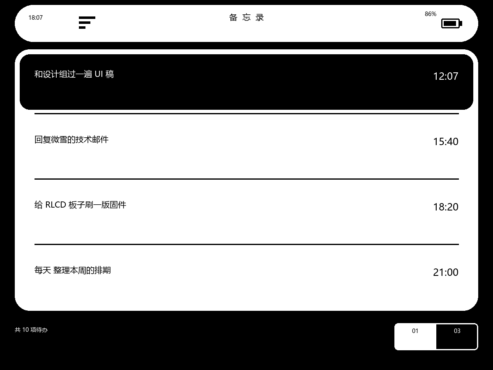
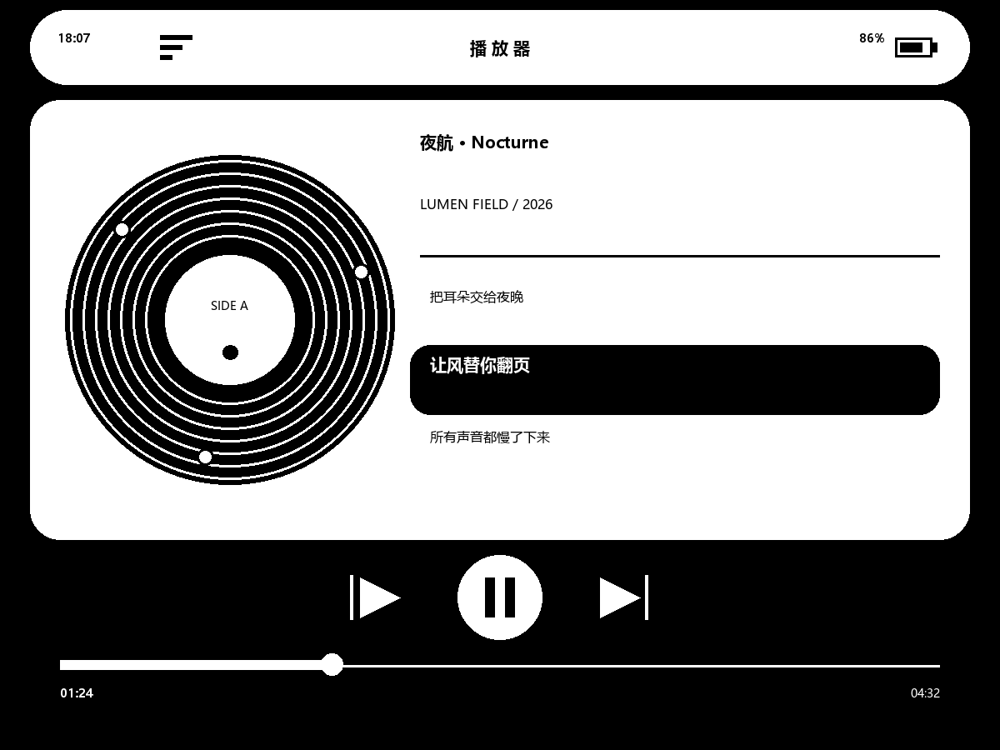
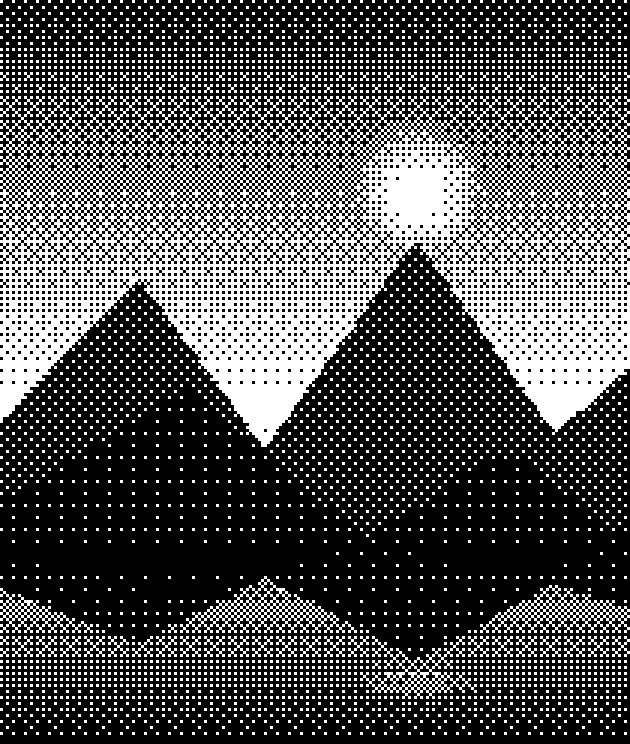
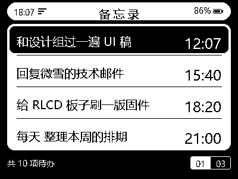
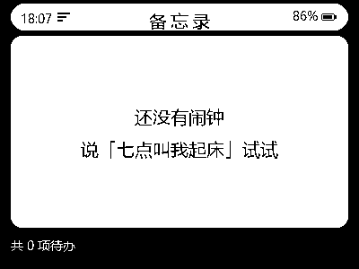
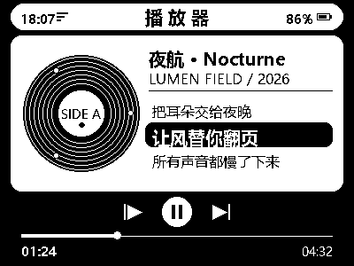

# 小智 AI · 微雪 ESP32-S3-RLCD-4.2 二次开发版

<p>
  <a href="https://github.com/78/xiaozhi-esp32"></a>
  
  
  
  
  
</p>

在 [xiaozhi-esp32](https://github.com/78/xiaozhi-esp32) 基础上，为**微雪 ESP32-S3-RLCD-4.2** 这块 400×300 单色反射屏做的深度定制：语音对话链路保持原样，界面从"能显示"改成"能看"，并补上了**提醒闹钟**、**本地音乐播放器**和**手机网页传图**三块实用功能。

所有交互都靠说话，屏幕本身不带触摸。

<p align="center">
  
  
  
</p>
<p align="center"><sub>左：提醒目录（黑底白卡，首条反白）　中：播放器（唱片 + 三行歌词 + 进度条）　右：照片抖动到 1-bit 的实际观感</sub></p>

---

## 目录

- [特性](#特性)
- [界面](#界面)
- [硬件](#硬件)
- [快速开始](#快速开始)
- [分区表](#分区表)
- [SD 卡目录](#sd-卡目录)
- [语音指令速查](#语音指令速查)
- [MCP 工具参考](#mcp-工具参考)
- [字库](#字库)
- [代码结构](#代码结构)
- [已知限制](#已知限制)
- [FAQ](#faq)
- [致谢](#致谢)

---

## 特性

| 分类 | 说明 |
|---|---|
| 🎙️ **语音对话** | 保留上游全部能力：离线唤醒词、AEC 回声消除、OPUS 编解码、WebSocket / MQTT+UDP 双协议、声纹识别 |
| ⏰ **提醒闹钟** | 一句话设提醒，掉电不丢（NVS），到点弹窗 + 语音播报，**响过即删**，每日重复自动滚到下一次 |
| 📋 **提醒目录页** | 独立页面按时间列出所有未响提醒，4 条/页、自动分页、首条反白、页脚计数 |
| 🎵 **本地音乐** | 读 SD 卡 MP3/WAV，唱片旋转、歌词滚动、进度条，纯语音控制播放/暂停/切歌/快进 |
| 🖼️ **每日壁纸** | SD 卡 JPEG 自动抖动成 1-bit，按日期轮换；手机浏览器打开设备 IP 即可传图/删图；无卡时用固件内置默认图 |
| 🌤️ **天气主页** | 时间、日期、室内温湿度、天气、电量、WiFi 一屏显示 |
| 🔤 **自建中文字库** | 20px、1bpp、GB2312 一级 3755 字，字重为单色屏重绘，小字不粘连 |
| 🔋 **电源管理** | 电量 ADC 采样、低电提醒、息屏省电 |

---

## 界面

三页循环，**USER 按键单击切换**（天气 → 提醒目录 → 音乐 → 天气），也可以用嘴切：「切到音乐页」「打开备忘录」「回到主页」。

### 提醒目录页

<p align="center">
  
  
</p>
<p align="center"><sub>左：3 条待办　右：空列表时卡片收缩为提示面板（1x 逐像素直出，等于真机看到的样子）</sub></p>

设计上的几个决定：

- **只显示"还没响"的**。单次提醒 `FireDue()` 触发后立即从 NVS 删除，每日重复项滚到明天同一时刻 —— 所以页面上永远只有待办，不需要额外过滤。
- **行高 53px、正文 20px、时间 24px 右对齐**。单色屏没有抗锯齿，字号低于 20px 时「微/雪/期」这类字会粘成一团。
- **首行整块反白**，配合内缩 4px 的圆角条，视觉上直接指出"下一条要响的是这个"。
- **卡片高度跟随条目数收缩**，页脚也跟着上移，不留一大块空白。

### 播放器页

<p align="center">
  
</p>

播放器页与提醒目录页共用同一套视觉语言：**黑底 + 白色胶囊头 + 白色圆角卡**。

- **唱片** 132px 黑圆嵌在白卡里，7 圈白纹、中心 `SIDE A` 白标，外圈 3 个点按 120° 公转（150ms/10°，约 6.7 秒一圈），暂停即停。白点带 1px 黑描边，压在白纹上也不会糊掉。
- **歌词** 3 行。协议只下发「上一句 / 当前句 / 下一句」，所以不做整首歌滚动，换句时整块滑回 180ms。**当前句是一条黑底白字的反白条**，和提醒目录首行反白是同一个语言：反白 = 此刻正在发生的那一条。
- **进度条** 1px 轨道 + 4px 已播段 + 9px 圆点，全部白色画在黑底上，左右分别是已播时间和总时长。
- **控制图标** `|◀ (❚❚) ▶|` 是用 ARGB8888 画布逐像素画的，不依赖图标字体，纯状态指示 —— 因为这块屏没有触摸，操作全靠说话。
- 时长来自 MP3 的 Xing 帧数或 CBR 码率推算，**不依赖 `.lrc` 文件**；快进用"解码丢弃"而不是 `fseek`，否则变码率 MP3 会跳偏。

---

## 硬件

| 项 | 参数 |
|---|---|
| 主控 | ESP32-S3 双核 240MHz，8MB Octal PSRAM，16MB Flash |
| 屏幕 | 400×300 **1-bit 反射式 LCD**（RLCD），SPI3 + TE 撕纸同步，无背光 |
| 音频 | ES8311 播放 + ES7210 录音，24kHz，I2S（MCLK 16 / WS 45 / BCLK 9 / DIN 10 / DOUT 8） |
| 传感器 | SHTC3 温湿度（I2C `0x70`）、PCF85063 RTC（I2C） |
| 存储 | microSD，SDMMC 1-bit，FAT32 |
| 按键 | BOOT（GPIO0）对话 / USER（GPIO18）切页 · 双击刷新 · 长按系统信息 |
| 电源 | 锂电池 + ADC1_CH3 采样，PA 使能 GPIO46 |
| 网络 | 2.4GHz WiFi |

> 屏幕是**单色**的：驱动层对每帧做二值化（`*buffer < 0x7fff`），颜色只剩黑与白，所以整套 UI 的设计前提是"用形状和反白表达层次"，而不是灰度。

---

## 快速开始

### 环境要求

- **ESP-IDF v5.5.5**（v5.1 及以下不兼容 LVGL 9）
- Python 3.11+（IDF 自带虚拟环境即可）
- 一块微雪 ESP32-S3-RLCD-4.2，一张 FAT32 的 microSD

### 编译

```powershell
# 1. 加载 IDF 环境（Windows）
. E:\esp\v5.5.5\esp-idf\export.ps1

# 2. 编译（板型已在 sdkconfig 里选好，直接用）
cd E:\esp32test\waveshare-rlcd-v2
idf.py build
```

> ⚠️ **不要跑 `idf.py set-target`**。它会把 `sdkconfig` 重置为默认值，板型选择（`CONFIG_BOARD_TYPE_WAVESHARE_S3_RLCD_4_2`）和分区表指向都会丢。真要重配就 `idf.py menuconfig`，在 `Xiaozhi Assistant → Board Type` 里选 `waveshare-s3-rlcd-4.2`。

> ⚠️ **不要在 Git Bash 里跑 `idf.py`**。它会检测到 `MSYSTEM` 变量并直接退出（提示 *MSys/Mingw is no longer supported*），必须用 PowerShell 或 cmd。

### 烧录

```powershell
idf.py -p COM3 flash monitor
```

**必须整片烧，不要用 `app-flash`。** 本项目的分区表和上游不同（见下节），只烧 app 会导致 assets 分区里的字体和图片找不到，界面空白或乱码。

烧完不需要重新配网：WiFi 凭据和提醒数据都在 NVS（`0x9000`），本项目的分区调整没有碰这一段。

---

## 分区表

`partitions/v2/16m.csv` 相对上游做了重排，目的是给 20px 中文字库腾地方：

```csv
# Name,   Type, SubType, Offset,   Size
nvs,      data, nvs,     0x9000,   0x4000,
otadata,  data, ota,     0xd000,   0x2000,
phy_init, data, phy,     0xf000,   0x1000,
ota_0,    app,  ota_0,   0x20000,  0x5F0000,
ota_1,    app,  ota_1,   0x610000, 0x5F0000,
assets,   data, spiffs,  0xC00000, 4M
```

| 分区 | 上游 | 现在 | 原因 |
|---|---|---|---|
| `assets` | `0xA00000 / 6M` | `0xC00000 / 4M` | 实际只用了 2.7MB，3.3MB 是空的 |
| `ota_0` / `ota_1` | 各 `0x4F0000` | 各 `0x5F0000` | 平分 assets 省下的 2MB，给字库和后续功能留余量 |
| `nvs` | `0x9000 / 0x4000` | **未动** | 保住 WiFi 凭据和提醒数据 |

原表备份在 `partitions/v2/16m.csv.bak-assets6m`。

**当前占用**：`xiaozhi.bin` 5,016,960 B / app 分区 6,225,920 B → **剩余约 19%**。

---

## SD 卡目录

```
/sdcard/
├── photos/          # 壁纸，JPEG，每天按日期轮换一张
│   ├── 001.jpg
│   └── 002.jpg
└── music/           # 音乐，MP3 / WAV
    ├── 晴天.mp3
    ├── 晴天.lrc      # 可选，同名歌词
    └── 夜曲.mp3
```

- 图片只认 `.jpg` / `.jpeg`，单张上限 8MB；驱动会把它抖动成 1-bit，尺寸自适应缩放。
- 音乐只认 `.mp3` / `.wav`；同名 `.lrc` 会被读进歌词区，格式为 `[mm:ss.xx]歌词`。
- 目录不存在时会自动创建，但**卡要在开机前插好**。

> 💡 **没有 SD 卡也能用。** 固件里编了一张默认壁纸（`assets/default_photo.c`，1bpp，6.5KB），
> `/sdcard/photos` 为空时主页直接显示它，不再是一片空白或提示文字。
> 提醒、天气、语音、字库全在 Flash / NVS 里，与卡无关；只有壁纸和本地音乐依赖 SD 卡。
>
> 想换这张默认图：`python tools/gen-default-photo.py <图片> --crop x,y,w,h --out-c .../assets/default_photo.c`
> （脚本会在 PC 上按固件同一套 Bayer 抖动算法压成 1bpp，再编译烧录即可）

### 传图（不用拔卡）

对设备说「**打开图片上传**」，它会回一个地址：

```
图片上传已开启：http://192.168.1.23
```

手机或电脑连同一个 WiFi，浏览器打开这个地址就能拖图、删图。传完主页立刻换成新图，不用重启。

**分辨率不用自己管。** 网页在发送前就会把图裁好缩好：按 210:248 居中裁剪（和屏幕上看到的构图一致）、缩到 420×496、转成 JPEG，一张通常只有 25~40KB。手机直出的 8MB 原图要传十几秒还容易断，这样是瞬间的事，SD 卡也不会被塞满。勾「保留原图」则原样上传。

万一绕过网页直接 POST（curl / 脚本），固件这边也兜底：

- 按目标尺寸自动挑解码缩放档位（1/2、1/4、1/8），4000×3000 的图走 1/8，解码缓冲从 9MB 降到 550KB；
- 缩小用**区域平均**而不是每格取一个点，衣服纹理、头发丝不会碎成噪点；
- 解码缓冲超过 6MB 的极端图直接跳过并打日志，不会把 PSRAM 拖崩。

实现上几点值得说明：

- 上传是 **`recv → fwrite` 流式落盘**，4KB 缓冲，传 8MB 的图也只占 4KB 内存。
- 服务**懒启动**，只有你说"打开图片上传"才起，平时不占 socket。
- 只收 JPEG —— 底层解码器和抖动渲染本来也只支持 JPEG（网页上传会自动转换，所以拖 PNG/HEIC 也能进）。
- 忘了地址就问「**图片上传地址是多少**」。

---

## 语音指令速查

### 提醒

| 说什么 | 效果 |
|---|---|
| 提醒我下午 3 点开会 | 新建 15:00 的提醒，自动跳到目录页 |
| 每天早上 7 点叫我起床 | 新建 07:00 的每日重复提醒 |
| 十分钟后提醒我喝水 | 模型自己换算成 `HH:MM` 再入库 |
| 我有什么待办 / 看看备忘 | 念出列表 + 自动切到目录页 |
| 翻页 / 下一页 / 上一页 | 目录页翻页 |
| 第一条做完了 | 标记完成并删除 |
| 等会儿再说 | 刚才响过的提醒延后 5 分钟 |
| 清空备忘 | 全部删除 |

提醒上限 10 条，每页 4 条，最多 3 页。

### 音乐

| 说什么 | 效果 |
|---|---|
| 播放晴天 | 按文件名匹配播放第一首 |
| 有没有周杰伦的歌 | 搜本地曲库，返回序号 + 名称 |
| 暂停 / 先停一下 / 继续播放 | 暂停与恢复（唱片同步停转） |
| 下一首 / 切歌 / 上一首 | 按文件名排序循环切换 |
| 快进 30 秒 / 后退一点 / 从头开始 | 相对或绝对定位 |
| 现在放的是什么歌 / 放到哪了 | 报歌名、歌手、进度 |
| 停止播放 / 关掉音乐 | 退出播放器 |

### 屏幕与图片

| 说什么 | 效果 |
|---|---|
| 切到音乐页 / 打开备忘录 / 回到主页 | 指定页面 |
| 切换屏幕 | 按三页循环切 |
| 换一张图 / 下一张壁纸 | 主页换壁纸 |
| 打开图片上传 / 图片上传地址是多少 | 启动上传服务 / 报地址 |

---

## MCP 工具参考

设备端通过 MCP 协议把这些工具暴露给大模型，工具名即能力边界。

### 系统与显示

| 工具 | 参数 | 说明 |
|---|---|---|
| `self.system.info` | — | CPU 频率、内存、电量、运行时长 |
| `self.weather.update` | — | 立即刷新天气 |
| `self.disp.network` | — | 重新进入配网模式 |
| `self.disp.switch` | `mode`: `toggle` \| `weather` \| `memo` \| `music` | 切换页面 |

### 提醒

| 工具 | 参数 | 说明 |
|---|---|---|
| `self.memo.add` | `content`, `time`(HH:MM), `repeat`(bool) | 新建提醒，写入 NVS，自动跳目录页 |
| `self.memo.list` | — | 列出未响的提醒，同时切到目录页 |
| `self.memo.page` | `direction`: `next` \| `prev` | 翻页 |
| `self.memo.done` | `index`(1–10) | 按序号完成并删除 |
| `self.memo.clear` | — | 清空全部 |
| `self.reminder.snooze` | `minutes`(1–120，默认 5) | 延后刚才响过的提醒 |

> `time` 必须是严格的 24 小时 `HH:MM`。工具说明里明确要求模型先把"五分钟后""晚上八点"换算成绝对时间再调用，否则会写进非法值。

### 音乐

| 工具 | 参数 | 说明 |
|---|---|---|
| `self.music.play_local` | `keyword`, `index` | 播放本地曲库中的第一匹配项 |
| `self.music.search` | `keyword`(可空) | 关键词检索，空串列出全部 |
| `self.music.pause` / `self.music.resume` | — | 暂停 / 继续 |
| `self.music.next` / `self.music.prev` | — | 上下一首（文件名排序循环） |
| `self.music.seek` | `seconds`(-3600–3600), `absolute_seconds` | 相对或绝对定位，绝对优先 |
| `self.music.stop` | — | 停止并退出播放 |
| `self.music.status` | — | 当前曲目与进度 |

### 图片

| 工具 | 参数 | 说明 |
|---|---|---|
| `self.photo.upload` | — | 启动网页上传服务，返回访问地址 |
| `self.photo.url` | — | 只查地址，不启动服务 |
| `self.photo.next` | — | 主页换下一张 |

---

## 字库

单色屏 + 中文，字库是绕不过去的坎。上游内置的 20px 字库（`font_puhui_20_4`）是 4bpp 的，体积 **1225KB**；而 4bpp 的灰阶信息会被 flush 阶段的二值化直接砍掉，等于白占一倍空间还糊。

所以自建了一个：

```text
main/boards/waveshare-s3-rlcd-4.2/assets/fonts/font_puhui_20_1.c
20px · 1bpp · GB2312 一级 3755 字 + ASCII + 标点 · 源码 1.4MB · 编译后约 222KB
.fallback = &font_puhui_16_4
```

生成命令：

```bash
lv_font_conv --font puhui-common.ttf --size 20 --bpp 1 --format lvgl --no-compress \
  -r 0x20-0x7F -r 0x3000-0x303F -r 0xFF00-0xFF5E \
  --symbols "$(cat build/fontgen/l1.txt)" --symbols "…—·" \
  -o font_puhui_20_1.c
```

几个踩过的坑：

- **RLE 压缩对 1bpp 无效**。单色位图熵太高，压完反而更大，`CONFIG_LV_USE_FONT_COMPRESSED` 保持 `n`。
- **字号不能退让**。对比图里 16px 的「微」「雪」「期」已经粘连，20px 才分得开 —— 见 `docs/preview/font-compare.png`。
- 只收一级常用字（3755 字），生僻字会被 fallback 到 16px 字库，显示出来偏小但不会缺字。

---

## 代码结构

```
main/boards/waveshare-s3-rlcd-4.2/
├── waveshare-s3-rlcd-4.2.cc     # 板级入口：音频/显示/按键初始化 + 全部 MCP 工具
├── config.h                     # 引脚定义
├── custom_lcd_display.{h,cc}    # 显示基类：页面管理、状态同步、二值化输出
├── weather_ui.cc                # 主页版式
├── memo_ui.cc                   # 提醒目录页版式
├── music_ui.cc                  # 播放器页版式
├── data_update_task.cc          # 后台刷新任务：时间/天气/温湿度/电量/WiFi/AI 状态
├── assets/fonts/
│   └── font_puhui_20_1.c        # 自建 20px 1bpp 中文字库
├── assets/default_photo.c       # 内置默认壁纸（1bpp 210×248，6.5KB）
└── managers/
    ├── reminder_manager.{h,cc}  # 提醒调度：NVS 持久化 + 到点触发
    ├── music_library.{h,cc}     # 曲库扫描与检索
    ├── photo_loader.{h,cc}      # JPEG 解码 → 缩放 → 抖动 → 1-bit
    ├── photo_web_server.{h,cc}  # 网页传图服务
    ├── sensor_manager.{h,cc}    # SHTC3 / PCF85063
    ├── weather_manager.{h,cc}   # 和风天气
    └── sdcard_manager.{h,cc}    # SD 卡挂载
```

三个 `*_ui.cc` 只负责画版式，数据由 `data_update_task.cc` 每秒推；页面切换、显隐、锁由 `custom_lcd_display.cc` 统一管。

`docs/` 下有两份长文值得看：

- [`docs/V2-IMPLEMENTATION-NOTES.md`](docs/V2-IMPLEMENTATION-NOTES.md) —— 每一处改动的原因、失败方案和取舍
- [`docs/MUSIC-LYRIC-COVER-NOTES.md`](docs/MUSIC-LYRIC-COVER-NOTES.md) —— 播放器页的排版推导

---

## 已知限制

- **屏幕只有黑白**，没有灰阶、没有背光。所有层次靠反白、描边、圆点、留白表达。
- **没有触摸**，全靠语音 + 两个物理按键。
- **歌词只有 3 行**，因为服务端协议只下发上下各一句，做不了整首滚动。
- **提醒上限 10 条**，超出会拒绝；这是 NVS 单条目大小和目录页 3 页的折中。
- **设备上只存 JPEG**：网页上传时会自动把 PNG/WebP/HEIC 转成 JPEG，但绕过网页直接 POST 就只能传 `.jpg` / `.jpeg`。
- **中文文件名会被压成下划线**：`屏幕截图.jpg` → `____.jpg`。功能正常（主页按顺序轮换，不看名字），只是网页列表里不好分辨。
- **OTA 升级要注意分区表**：分区布局与上游 v2 不同，从上游固件直接 OTA 过来会写坏 assets 区，必须整片重烧一次。

---

## FAQ

**Q：只烧 app 行不行？**
不行。分区表变了，`assets` 从 `0xA00000` 挪到了 `0xC00000`，只烧 app 会导致字体和图片找不到。用 `idf.py flash` 整片烧。

**Q：烧完要不要重新配网？**
不用。NVS 在 `0x9000`，这次分区调整没碰它，WiFi 密码和提醒都会保留。

**Q：为什么截图里的字看起来有点"硬"？**
因为这就是真机效果 —— 1-bit 屏没有抗锯齿，笔画非黑即白。所有 1x 预览图都是逐像素直出后再阈值化的，没有做过缩放，和你眼睛看到的一致。

**Q：Git Bash 里 `idf.py` 直接退出？**
`idf.py` 检测到 `MSYSTEM` 环境变量就会拒绝运行（哪怕值是空的）。用 PowerShell。

**Q：网页打不开？**
确认手机和设备在同一网段（很多路由器开了 AP 隔离会挡住）、设备已连上 WiFi、地址是设备报的那个而不是记忆中的旧 IP。

**Q：能放网易云/QQ 音乐吗？**
不能。只读 SD 卡本地文件，没有在线音乐源的授权。

---

## 致谢

- [78/xiaozhi-esp32](https://github.com/78/xiaozhi-esp32) —— 整套语音交互框架、MCP 协议实现、板级抽象
- [LVGL](https://lvgl.io/) —— 图形库（v9.4.0）
- [lv_font_conv](https://github.com/lvgl/lv_font_conv) —— 字库转换
- [微雪电子](https://www.waveshare.net/) —— ESP32-S3-RLCD-4.2 硬件与原始驱动

## 许可

沿用上游 [MIT License](LICENSE)。
